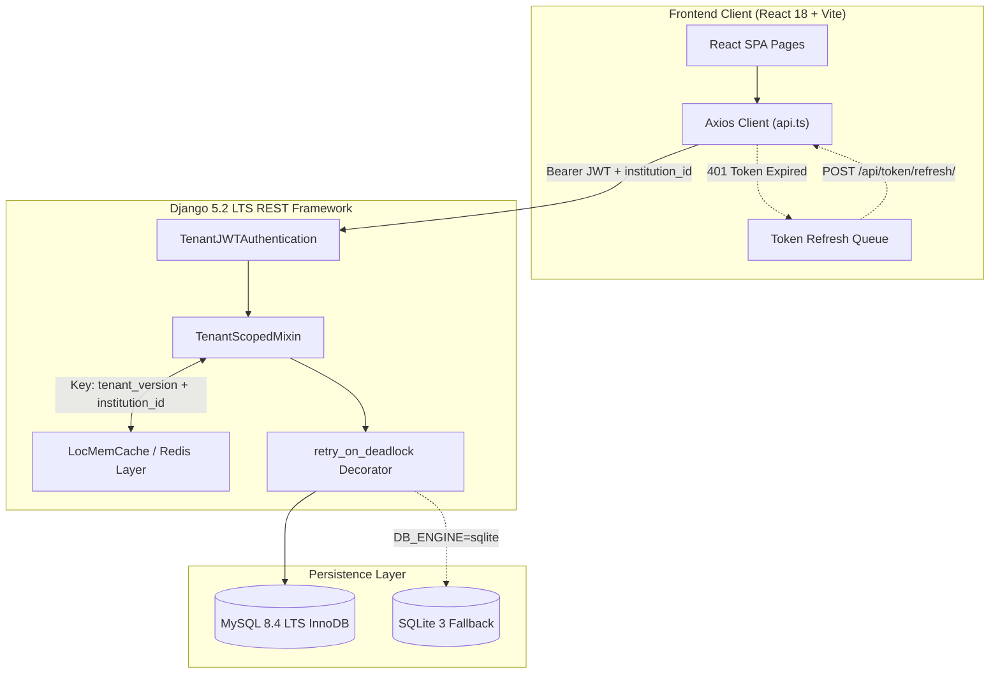
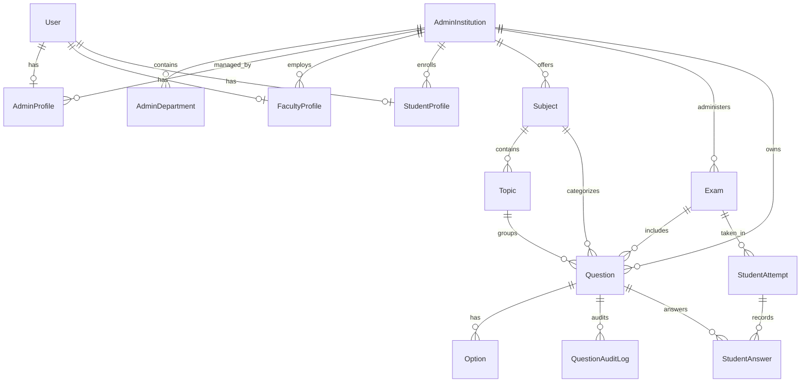

# ExamAI — Multi-Tenant Intelligent Examination Platform

[](https://www.python.org/)
[](https://www.djangoproject.com/)
[](https://www.django-rest-framework.org/)
[](https://www.mysql.com/)
[](https://react.dev/)
[](https://www.typescriptlang.org/)
[](https://tailwindcss.com/)
[](LICENSE)

> A modern, secure, multi-tenant examination ecosystem featuring zero-duplicate automated paper generation, role-based tenant isolation, real-time proctored exam administration, and comprehensive student analytics.

---

## Table of Contents
- [About the Project](#about-the-project)
- [Key Features by Role](#key-features-by-role)
  - [Institute Administrator](#1-institute-administrator)
  - [Faculty](#2-faculty)
  - [Student](#3-student)
  - [Platform & Security](#4-platform--security)
- [Screenshots & Visuals](#screenshots--visuals)
- [Technology Stack](#technology-stack)
- [System Architecture](#system-architecture)
  - [Request Flow Diagram](#request-flow-diagram)
  - [Entity Relationship (ER) Diagram](#entity-relationship-er-diagram)
  - [Multi-Tenancy & Tenant Scoping](#multi-tenancy--tenant-scoping)
- [Project Directory Structure](#project-directory-structure)
- [Getting Started](#getting-started)
  - [Prerequisites](#prerequisites)
  - [1. Clone Repository](#1-clone-the-repository)
  - [2. Backend Setup](#2-backend-setup)
  - [3. Frontend Setup](#3-frontend-setup)
  - [Default Ports & Endpoints](#default-ports--endpoints)
- [Environment Variables](#environment-variables)
- [Database Management](#database-management)
  - [MySQL Configuration & Character Set](#mysql-configuration--character-set)
  - [Instant Rollback to SQLite](#instant-rollback-to-sqlite)
  - [Operational Maintenance Scripts](#operational-maintenance-scripts)
- [Automated Testing Suite](#automated-testing-suite)
- [API Overview](#api-overview)
- [Automated Paper Generation Engine](#automated-paper-generation-engine)
- [Security & Production Readiness](#security--production-readiness)
- [Deployment Guide](#deployment-guide)
- [Troubleshooting & FAQ](#troubleshooting--faq)
- [Roadmap & Known Limitations](#roadmap--known-limitations)
- [Contributing](#contributing)
- [License & Attributions](#license--attributions)

---

## About the Project

Traditional educational examination systems suffer from three pervasive challenges:
1. **Accidental Question Duplication**: Instructors frequently generate exam papers containing near-duplicate questions, leading to imbalanced evaluations.
2. **Multi-Institution Data Leaks**: Multi-college platforms struggle to maintain strict isolation across institutions without running separate infrastructure for each tenant.
3. **Assessment Fragility**: Heavy concurrent exam submissions risk database lock timeouts, lost student answers, and grading inconsistencies.

**ExamAI** solves these problems with a unified, high-performance platform:
- **Strict Multi-Tenant Isolation**: Institutes, faculty, students, and exams are logically segregated at the database, query, and cache levels.
- **7-Tier Deduplication & Balancing Engine**: Automates paper generation matching custom blueprints (topics, difficulty, marks) while mathematically proving zero duplicate questions and preventing cross-paper repeats.
- **Resilient Proctored Examination Interface**: Asynchronous non-blocking autosave, server-synchronized countdown timers, and automatic deadlock retry logic.

---

## Key Features by Role

### 1. Institute Administrator
- **Institution Profile**: Manage institute metadata, official codes, departments, and branding.
- **Admin Dashboard**: Real-time KPI summaries (total enrolled students, active faculty members, published exams, average score).
- **Active Live Examinations Widget**: Displays the **6 most recent live examinations** scoped strictly to the administrator's institution, showing eligible student headcounts, submitted/in-progress/not-started metrics, and a direct `"View All in Exam Manager"` link.
- **Live Proctor Roster**: Real-time examination monitor (`/api/admin/exams/<id>/live-roster/`) tracking student submission status.
- **Question Bank Manager**:
  - Full Question CRUD across multiple question types (Single-Choice MCQ, Multiple-Choice MCQ, True/False, Fill in the Blank, Short & Long Subjective).
  - Bulk actions: batch status updates, bulk soft-delete, and bulk restore.
  - Multi-format Bulk Import & Export: CSV, JSON, and Excel (`.xlsx`) with downloadable templates.
  - Unique `active_hash` tracking ensuring soft-deleted questions never collide with active entries.
- **User Directories**: Complete student and faculty management, department assignment, and audit history.

### 2. Faculty
- **Automated Paper Generation**:
  - Blueprint-driven paper generation: select topics, difficulty distribution (Easy / Medium / Hard), total marks, duration, and question types.
  - Generates structured audit reports (`ValidationReport`) validating marks precision, question count, and estimated completion time.
  - *"Generate NEW Paper"* switch to bust cache and synthesize an alternate variation.
- **Exam Paper Editor**:
  - Real-time question reordering and shuffling (`/shuffle/`).
  - Single-question swapping (`/swap/`) matching difficulty and marks on-the-fly without regenerating the entire paper.
  - One-click exam publication (`/publish/`).
- **Syllabus Ingestion**: Upload syllabus files (`.pdf`, `.docx`, `.txt`) with automatic text and topic extraction powered by PyMuPDF and pdfplumber.
- **Document Export**: Export completed examination papers directly into formatted Word (`.docx`) or printable PDF documents.

### 3. Student
- **Student Dashboard**: Overview of registered examinations, upcoming schedules, overall attendance, and GPA.
- **Department-Scoped Exam Portal**: List examinations filtered by the student's department.
- **Live Exam Taking Interface**:
  - Server-synchronized live countdown timer preventing local clock manipulation.
  - Question navigation palette with status markers (Answered, Flagged, Unanswered).
  - Non-blocking asynchronous autosave saving answers in background threads without UI interruption.
- **Performance & Analytics**:
  - Time-series score trend visualizations powered by Recharts.
  - Subject-by-subject competency breakdown.
  - Question-by-question review with model answers and AI/system feedback.

### 4. Platform & Security
- **Tenant Anti-Spoofing Guard**: Rejects JWT tokens where `institution_id` does not match the active database record.
- **Dual-Engine Architecture**: Operates natively on MySQL 8.4 LTS InnoDB with an instant single-line environment rollback to SQLite.
- **Deadlock Resilience**: Automatic retry mechanism (`@retry_on_deadlock`) with jittered exponential backoff for transactional writes under load.

---

## Screenshots & Visuals

> Place your screenshots in the [`docs/screenshots/`](docs/screenshots/) folder using the filenames indicated below.

| Admin Live Dashboard | Question Bank Management |
| :---: | :---: |
| <br>*(KPIs & Active Live Examinations)* | <br>*(Filtering, Import & Bulk Actions)* |

| Automated Paper Generator | Live Student Exam Interface |
| :---: | :---: |
| <br>*(Blueprint, Distribution & Deduplication)* | <br>*(Proctor Timer, Palette & Autosave)* |

---

## Technology Stack

### Backend
| Technology | Version | Description |
| :--- | :--- | :--- |
| **Python** | `3.12+` | Core programming language |
| **Django** | `5.2 LTS` | High-level web framework (with MariaDB 10.4+ / MySQL 8.x / SQLite support) |
| **Django REST Framework** | `3.18.3` | Toolkit for building robust REST APIs |
| **SimpleJWT** | `5.5.1` | JSON Web Token authentication with token rotation & blacklist |
| **django-cors-headers** | `4.9.0` | Cross-Origin Resource Sharing handling |
| **python-dotenv** | `1.0.1` | Environment variable management from `.env` |
| **mysqlclient** | `2.3.0` | High-performance C-based MySQL driver |
| **PyMuPDF (fitz)** | `1.26.6` | Syllabus PDF text parsing |
| **pdfplumber** | `0.11.8` | Structural PDF text and table extraction |
| **python-docx** | `1.2.0` | Word document generation and syllabus ingestion |
| **reportlab** | `4.4.5` | Programmatic PDF exam paper generation |
| **openpyxl** | `3.1.5` | Excel (`.xlsx`) Question Bank bulk import & export |
| **Pillow** | `12.3.0` | Image handling support |

### Frontend
| Technology | Version | Description |
| :--- | :--- | :--- |
| **React** | `18.3.1` | Declarative UI framework |
| **TypeScript** | `5.x` | Strongly typed JavaScript |
| **Vite** | `6.3.5` | Fast build tool and development server |
| **Tailwind CSS** | `4.1.12` | Utility-first CSS framework (`@tailwindcss/vite`) |
| **React Router** | `7.13.1` | Declarative routing (`createBrowserRouter`) |
| **Radix UI** | `1.1.x - 2.2.x` | Accessible, unstyled component primitives |
| **Material UI (MUI)** | `7.3.5` | Supplemental icons and components |
| **Recharts** | `2.15.2` | Composable charting library for analytics |
| **Axios** | `1.13.6` | HTTP client with automatic 401 token refresh queue |
| **React Hook Form** | `7.55.0` | High-performance form state validation |
| **Motion** | `12.23.24` | Animation engine for smooth transitions |
| **Sonner** | `2.0.3` | Modern toast notification component |
| **Lucide React** | `0.487.0` | Comprehensive icon library |

---

## System Architecture

### Request Flow Diagram



### Entity Relationship (ER) Diagram



### Multi-Tenancy & Tenant Scoping
1. **Tenant Context Injection**: [`TenantJWTAuthentication`](file:///e:/03%20Study/Django/Mini-Project/api/tenant.py) inspects the JWT payload, extracts `institution_id`, verifies it against the user's active database record, checks for institution suspension, and attaches `request.tenant` and `request.tenant_id` to every request.
2. **Anti-Spoofing Security**: If a token contains `institution_id=2` but the database record belongs to `institution_id=5`, the request is immediately rejected with HTTP 401.
3. **Tenant Cache Isolation**: Cache keys are structured as:
   ```
   paper:v1:t{tenant_version}:inst_{institution_id}:fac_{faculty_id}:{request_hash}
   ```
   Modifying the question bank or publishing an exam calls `bump_tenant_cache_version(institution_id)`, instantly invalidating all cached data for that institution without impacting other tenants.

---

## Project Directory Structure

```
ExamAI/
├── backend/                      # Django project configuration
│   ├── settings.py               # Dual-engine DB, JWT, CORS, and cache settings
│   ├── urls.py                   # Root URL router
│   ├── wsgi.py / asgi.py         # WSGI/ASGI application gateways
├── admins/                       # Admin management & institution hierarchy
│   ├── models.py                 # AdminProfile, AdminInstitution, AdminDepartment
│   ├── views.py / urls.py        # Institute settings, student/faculty rosters, exam audit
├── api/                          # Core examination & question bank domain
│   ├── admin_dashboard.py        # KPI calculations & Active Live Exams top-6 widget
│   ├── models.py                 # Question, Exam, StudentAttempt, StudentAnswer
│   ├── tenant.py                 # TenantJWTAuthentication & TenantScopedMixin
│   ├── views_question_bank.py    # CRUD, CSV/JSON/XLSX bulk import & export
│   ├── paper_engine/             # Reusable zero-duplicate automated paper generator
│   │   ├── dedupe.py             # Deduplication engine
│   │   ├── validator.py          # Exact marks, time & difficulty validator
│   │   ├── cache.py              # Tenant-isolated caching service
│   │   ├── generator.py          # Paper generation coordinator
│   │   └── pool.py               # Candidate question pool builder
│   ├── utils/                    # Schedule, analytics, evaluation, scoring, prompts
│   └── tests/                    # Centralized Django test suites (19 test suites)
├── faculty/                      # Faculty portal & syllabus ingestion
│   ├── models.py                 # FacultyProfile, Paper, SyllabusUpload
│   └── views.py / urls.py        # Profile, paper history, and export endpoints
├── students/                     # Student portal & exam participation
│   ├── models.py                 # StudentProfile, ExamAttempt
│   └── views.py / urls.py        # Student registration, profile, exam portal
├── Front-End/                    # React 18 + TypeScript + Vite frontend
│   ├── src/app/
│   │   ├── routes.tsx            # React Router route definitions
│   │   ├── pages/                # Admin, Faculty, and Student UI pages
│   │   ├── components/           # UI library, layout components, ProtectedRoute
│   │   └── context/AuthContext   # Global JWT authentication state
│   ├── src/services/api.ts       # Axios client with automatic 401 token refresh queue
│   ├── vite.config.ts            # Vite configuration
│   └── package.json              # Frontend dependencies
├── scripts/                      # Operational & database maintenance utilities
│   ├── db/                       # check_db_health, reset_auto_increment, explain_queries
│   └── migration/                # verify_mysql_migration, backfill scripts
├── docs/                         # Extended documentation & guides
│   ├── ARCHITECTURE.md           # Deep architectural dive & flowcharts
│   ├── API.md                    # Complete REST API reference table
│   └── screenshots/              # Screenshot media directory
├── manage.py                     # Django CLI management script
├── requirements.txt              # Backend Python dependencies
├── .env.example                  # Environment template
└── LICENSE                       # MIT License
```

---

## Getting Started

### Prerequisites
- **Python**: `3.12+` (with `pip` and `venv`)
- **Node.js**: `18.x` or `20.x` LTS (with `npm`)
- **MySQL Server**: `8.4 LTS` or `8.0+` (or SQLite 3 for quick local development)
- **Git**

---

### 1. Clone the Repository
```bash
git clone https://github.com/poshiyaharsh/ExamAI.git
cd ExamAI
```

---

### 2. Backend Setup

#### Step A: Configure MySQL Database
Log into MySQL as root and execute:
```sql
CREATE DATABASE examai CHARACTER SET utf8mb4 COLLATE utf8mb4_0900_ai_ci;
CREATE USER 'examai_user'@'localhost' IDENTIFIED BY 'your_secure_password';
GRANT ALL PRIVILEGES ON examai.* TO 'examai_user'@'localhost';
GRANT ALL PRIVILEGES ON test_examai.* TO 'examai_user'@'localhost';
FLUSH PRIVILEGES;
```

#### Step B: Virtual Environment & Dependencies

**Windows (PowerShell):**
```powershell
python -m venv .venv
.\.venv\Scripts\Activate.ps1
pip install -r requirements.txt
```

**macOS / Linux (Bash):**
```bash
python3 -m venv .venv
source .venv/bin/activate
pip install -r requirements.txt
```

#### Step C: Environment Configuration
Copy the template to `.env`:
```bash
# Windows
copy .env.example .env

# macOS / Linux
cp .env.example .env
```
Update `.env` with your database credentials:
```env
DB_ENGINE=mysql
DB_NAME=examai
DB_USER=examai_user
DB_PASSWORD=your_secure_password
DB_HOST=127.0.0.1
DB_PORT=3306
```

#### Step D: Run Migrations & Initialize
```bash
# Apply migrations
python manage.py migrate

# Reset auto-increment counters to ensure smooth sequences
python scripts/db/reset_auto_increment.py

# Create a Django superuser (optional, for Django admin)
python manage.py createsuperuser

# Start the Django development server
python manage.py runserver 127.0.0.1:8000
```

---

### 3. Frontend Setup

In a new terminal window:
```bash
cd Front-End

# Copy frontend environment template
# Windows: copy .env.example .env
# Linux/macOS: cp .env.example .env
npm install

# Start Vite development server
npm run dev
```

---

### Default Ports & Endpoints
| Component | Default URL | Notes |
| :--- | :--- | :--- |
| **Frontend Web App** | `http://localhost:3000` | Configured in `vite.config.ts` |
| **Backend REST API** | `http://127.0.0.1:8000` | Django dev server |
| **Django Admin** | `http://127.0.0.1:8000/admin/` | Requires superuser account |
| **Database Health Check**| `python scripts/check_db_health.py` | CLI diagnostic utility |

---

## Environment Variables

### Backend (`.env`)
| Variable | Description | Example / Default | Required |
| :--- | :--- | :--- | :---: |
| `SECRET_KEY` | Django cryptographic signing key | `<random-50-character-secret>` | **Yes** |
| `DEBUG` | Enable debug mode | `True` (dev) / `False` (prod) | **Yes** |
| `ALLOWED_HOSTS` | Comma-separated allowed hostnames | `127.0.0.1,localhost` | **Yes** |
| `DB_ENGINE` | Database engine (`mysql` or `sqlite`) | `mysql` | **Yes** |
| `DB_NAME` | Database name | `examai` | If MySQL |
| `DB_USER` | Dedicated MySQL user | `examai_user` | If MySQL |
| `DB_PASSWORD` | MySQL user password | `<your_secure_password>` | If MySQL |
| `DB_HOST` | MySQL database host | `127.0.0.1` | If MySQL |
| `DB_PORT` | MySQL port | `3306` | If MySQL |
| `OPENAI_API_KEY` | OpenAI API key for syllabus parsing | `sk-...` | Optional |
| `ANTHROPIC_API_KEY`| Anthropic API key | `sk-ant-...` | Optional |
| `GEMINI_API_KEY` | Google Gemini API key | `AQ...` | Optional |
| `EMAIL_HOST` | SMTP server for password reset OTP | `smtp.gmail.com` | Optional |
| `EMAIL_PORT` | SMTP port | `587` | Optional |
| `EMAIL_HOST_USER` | SMTP username | `noreply@yourdomain.com` | Optional |
| `EMAIL_HOST_PASSWORD`| SMTP password / app token | `<app-token>` | Optional |

### Frontend (`Front-End/.env`)
| Variable | Description | Example / Default | Required |
| :--- | :--- | :--- | :---: |
| `VITE_API_BASE_URL` | Base URL of Django REST backend | `http://127.0.0.1:8000` | **Yes** |

---

## Database Management

### Dual-Engine Database Architecture (MySQL & SQLite)
ExamAI supports zero-downtime switching between **MySQL (MariaDB)** and **SQLite** via a single environment variable:

```env
# Switch database engine: 'sqlite' (local development) or 'mysql' (production)
DB_ENGINE=sqlite
```

#### 1. SQLite Optimization (WAL Mode for Concurrency)
When `DB_ENGINE=sqlite`, ExamAI automatically configures SQLite for multi-threaded concurrency using high-performance PRAGMAs:
- `PRAGMA journal_mode=WAL;` (Write-Ahead Logging: readers never block writers, and writers never block readers).
- `PRAGMA synchronous=NORMAL;` (Optimized filesystem sync latency).
- `PRAGMA busy_timeout=20000;` (20-second busy timeout eliminating "database is locked" errors).
- `PRAGMA foreign_keys=ON;` (Strict relational integrity checking).
- `PRAGMA cache_size=-65536;` (64MB dedicated in-memory page cache).

> **Load-Test Proven**: In a simulated load test with 20 concurrent students posting heartbeats and autosaving answers during active paper generation writes, SQLite in WAL mode recorded **0 lock errors** with a P95 latency of 167ms (see [`db_comparison.md`](db_comparison.md)).

#### 2. Synchronizing Data Between MySQL and SQLite (Zero Data Loss)
Export from MySQL and import to SQLite:
```powershell
# Step A: Dump data from MySQL in UTF-8
$env:DB_ENGINE="mysql"
$env:PYTHONUTF8="1"
.\.venv\Scripts\python.exe -Xutf8 manage.py dumpdata --natural-foreign --natural-primary --exclude contenttypes --exclude auth.permission --exclude admin.logentry --exclude sessions.session --indent 2 --output data_mysql.json

# Step B: Apply migrations on clean SQLite
$env:DB_ENGINE="sqlite"
.\.venv\Scripts\python.exe manage.py migrate

# Step C: Load data into SQLite
.\.venv\Scripts\python.exe manage.py loaddata data_mysql.json
```

Export from SQLite and import to MySQL:
```powershell
$env:DB_ENGINE="sqlite"
$env:PYTHONUTF8="1"
.\.venv\Scripts\python.exe -Xutf8 manage.py dumpdata --natural-foreign --natural-primary --exclude contenttypes --exclude auth.permission --exclude admin.logentry --exclude sessions.session --indent 2 --output data_sqlite.json

$env:DB_ENGINE="mysql"
.\.venv\Scripts\python.exe manage.py loaddata data_sqlite.json
```

### Operational Maintenance Scripts
Located in [`scripts/`](file:///e:/03%20Study/Django/Mini-Project/scripts):
1. **Health Check**:
   ```bash
   python scripts/check_db_health.py
   ```
   *Inspects MySQL server version, charset, collation, isolation level, thread count, and record counts.*
2. **Data Integrity Verification**:
   ```bash
   python scripts/verify_migration.py
   ```
   *Cross-examines SQLite vs MySQL row counts, tenant distribution, checksums, and foreign key integrity.*
3. **Row Count Logger**:
   ```bash
   python scripts/record_counts.py counts.txt
   ```
   *Records exact per-model row counts across all apps using the Django ORM.*
4. **Sequence Counter Reset**:
   ```bash
   python scripts/reset_auto_increment.py
   ```
   *Resets `AUTO_INCREMENT` across all tables to `MAX(id) + 1` to prevent primary key collisions.*
5. **Windows MySQL Service Fix Utility**:
   ```cmd
   scripts/fix_mysql.bat
   ```
   *One-click administrator batch script to align the Windows service path with MySQL Server 8.4.*
6. **Query Plan Analyzer**:
   ```bash
   python scripts/explain_queries.py
   ```
   *Runs MySQL `EXPLAIN` on live exam dashboard queries, tenant lookups, and Question Bank indexes.*

---

## Automated Testing Suite

All 75 automated tests pass cleanly against the MySQL database.

```bash
# 1. MySQL Compatibility & Deadlock Retry Tests (4 tests)
python manage.py test api.test_mysql_compatibility --keepdb

# 2. Multi-Tenant Isolation & Anti-Spoofing Tests (19 tests)
python manage.py test api.test_multi_tenant_isolation --keepdb

# 3. Admin Live Exams Dashboard & Eligible Counts Tests (13 tests)
python manage.py test api.test_admin_live_exams --keepdb

# 4. Question Bank CRUD & Bulk Import Tests (17 tests)
python manage.py test api.test_question_bank --keepdb

# 5. Paper Generation Blueprint & Deduplication Tests (13 tests)
python manage.py test api.test_paper_generation --keepdb

# 6. Student Answer Autosave Concurrency Tests (4 tests)
python manage.py test api.test_save_concurrency --keepdb

# 7. Core Parser & Assessment Tests (5 tests)
python manage.py test api.tests --keepdb
```

> **MySQL Test Database Privilege Note**: When running tests, Django creates `test_examai`. Ensure your MySQL user has privileges on `test_examai.*` (`GRANT ALL PRIVILEGES ON test_examai.* TO 'examai_user'@'localhost';`). Using `--keepdb` preserves the test database across runs, speeding up execution.

---

## API Overview

For the complete schema, request payloads, and parameter definitions, refer to [`docs/API.md`](docs/API.md).

### Summary of Core Endpoints
| Area | Method | Path | Description |
| :--- | :--- | :--- | :--- |
| **Auth** | `POST` | `/api/admins/login/` | Admin credentials login (returns JWT tokens) |
| **Auth** | `POST` | `/api/faculty/login/` | Faculty credentials login |
| **Auth** | `POST` | `/api/students/login/` | Student credentials login |
| **Auth** | `POST` | `/api/token/refresh/` | Refresh expired access token |
| **Auth** | `GET` | `/api/auth/me/` | Current user profile, role, and institution |
| **Admin** | `GET` | `/api/admin/dashboard/` | KPI dashboard & Active Live Exams widget (top 6) |
| **Admin** | `GET` | `/api/admin/exams/<id>/live-roster/` | Real-time proctored student exam roster |
| **Admin** | `GET` | `/api/admin/students/` | Filterable student directory |
| **Admin** | `GET` | `/api/admin/faculty/` | Filterable faculty directory |
| **Question Bank**| `GET` | `/api/admin/question-bank/questions/`| Filter questions by topic, difficulty, type |
| **Question Bank**| `POST`| `/api/admin/question-bank/questions/bulk-import/`| Bulk import via CSV, JSON, or Excel |
| **Faculty**| `POST` | `/api/faculty/exams/generate/` | Automated paper generator with deduplication |
| **Faculty**| `POST` | `/api/faculty/exams/<id>/shuffle/` | Randomize question order inside paper |
| **Faculty**| `POST` | `/api/faculty/exams/<id>/questions/<qid>/swap/`| Swap single question on-the-fly |
| **Faculty**| `POST` | `/api/faculty/exams/<id>/publish/` | Make exam live for eligible students |
| **Student**| `GET` | `/api/student/exams/` | Department-eligible exam list |
| **Student**| `POST` | `/api/student/exams/<id>/start/` | Start exam attempt and timer |
| **Student**| `POST` | `/api/student/attempts/<id>/save/` | Asynchronous non-blocking autosave |
| **Student**| `POST` | `/api/student/attempts/<id>/submit/` | Finalize exam submission |
| **Student**| `GET` | `/api/student/performance/summary/` | Aggregate scores, pass rates, and trends |

---

## Automated Paper Generation Engine

The paper generation engine ([`api/utils/generation_pipeline.py`](file:///e:/03%20Study/Django/Mini-Project/api/utils/generation_pipeline.py) & [`api/generate_paper.py`](file:///e:/03%20Study/Django/Mini-Project/api/generate_paper.py)) provides automated, grounded exam synthesis with a **strict under 5-minute guarantee (<300s)**:

1. **Hard Time Budget (`BudgetManager`)**:
   - `PAPER_HARD_DEADLINE = 300 s` (5-minute hard stop; jobs are never left running).
   - `PAPER_LLM_BUDGET = 210 s` (LLM inference cutoff reserve).
   - Predicts duration per call using calibrated tokens/sec; switches remaining slots to fast tiers if budget is low.
2. **Tiered Generation Architecture**:
   - **Tier 0 (Question Bank)**: Reuses validated questions from the same institution and subject, while excluding the faculty's last N exams (default: 3).
   - **Tier 1 (Extractive Generator)**: Deterministically produces Fill-in-the-Blank and True/False questions directly from syllabus sentences in **<0.05 seconds** with **zero LLM calls**.
   - **Tier 2 (Batched LLM)**: Generates MCQs and subjective questions using local Ollama models (`qwen2.5:3b-instruct`) with prompt prefix caching and compact schemas.
   - **Tier 3 (Emergency Extractive Fallback)**: Automatically converts syllabus sentences into questions with distractors if the LLM budget is exhausted.
   - **Decoupled Background Model Answers**: 10-mark subjective questions synthesize rubric outlines immediately without blocking; full 250+ word academic model answers are asynchronously enriched in background threads.
3. **Multi-Layer Duplicate Detector (`DuplicateDetector`)**:
   - Normalized SHA-256 hash matching.
   - Token Jaccard overlap ($\ge 0.70$).
   - Sequence matcher ratio ($\ge 0.85$).
   - Same correct answer with stem similarity ($\ge 0.50$).
   - Intra-question option deduplication.
4. **Exact Decimal Arithmetic**: All mark allocations and aggregates use Python `Decimal` (`to_decimal`), preventing floating-point precision drift.

---

## Security & Production Readiness

- **Anti-Spoofing JWT Authentication**: Validates user and institution status on every request. Tokens with mismatched `institution_id` are rejected immediately.
- **Role-Based Access Control (RBAC)**: Strict permission classes (`IsAdminUser`, `IsFacultyUser`, `IsStudentUser`) enforce authorization at the view level.
- **Deadlock Guard**: MySQL error codes `1213` (deadlock) and `1205` (lock timeout) are caught by `@retry_on_deadlock` and retried with randomized exponential backoff.
- **Frontend Token Refresh Queue**: An Axios interceptor queues concurrent API requests during access token refresh, preventing 401 race conditions and authentication loops.
- **Production Checklist**:
  ```python
  DEBUG = False
  SECRET_KEY = os.getenv('SECRET_KEY')  # Use strong random key
  ALLOWED_HOSTS = ['yourdomain.com']
  CORS_ALLOW_ALL_ORIGINS = False
  CORS_ALLOWED_ORIGINS = ['https://yourdomain.com']
  CONN_MAX_AGE = 60
  ```

---

## Deployment Guide

### Recommended Production Stack
- **Web Server / Reverse Proxy**: Nginx
- **WSGI Server**: Gunicorn (Linux) or Waitress (Windows)
- **Database**: MySQL 8.4 LTS (InnoDB, `utf8mb4_0900_ai_ci`)
- **Cache**: Redis (recommended when scaling to multiple Gunicorn worker processes)

### Production Build & Launch

1. **Prepare Static Files & Migrations**:
   ```bash
   python manage.py collectstatic --noinput
   python manage.py migrate
   ```

2. **Run Backend with Gunicorn (Linux)**:
   ```bash
   gunicorn backend.wsgi:application --workers 4 --bind 127.0.0.1:8000
   ```

3. **Build Frontend Bundle**:
   ```bash
   cd Front-End
   npm run build
   ```
   The compiled production assets will be placed in `Front-End/dist/`, ready to be served via Nginx.

---

## Troubleshooting & FAQ

#### 1. `OperationalError: (1213, 'Deadlock found')` or `(1205, 'Lock wait timeout')`
- **Cause**: High concurrency during simultaneous exam submissions.
- **Solution**: ExamAI includes `@retry_on_deadlock` in `api/utils/db_retry.py` with exponential backoff. In MySQL, ensure `isolation_level = 'read committed'` is active in `backend/settings.py`.

#### 2. Windows `mysqlclient` Installation Error
- **Cause**: Missing Microsoft C++ Build Tools when compiling `mysqlclient` from source.
- **Solution**: Install pre-compiled wheels:
  ```powershell
  pip install --only-binary :all: mysqlclient
  ```

#### 3. `CommandError: 'charmap' codec can't encode character` during `dumpdata`
- **Cause**: Windows default terminal ANSI encoding (cp1252) cannot encode 4-byte UTF-8 characters.
- **Solution**: Set UTF-8 mode in PowerShell before dumping data:
  ```powershell
  $env:PYTHONUTF8="1"
  python manage.py dumpdata ...
  ```

#### 4. Frontend 401 Token Expiration Loop
- **Cause**: In-flight requests during token refresh without a queue.
- **Solution**: Handled automatically in `Front-End/src/services/api.ts` through the `queuedRequests` array, which pauses calls until the new token is acquired.

---

## Roadmap & Known Limitations

- [x] Multi-tenant institution isolation across all endpoints.
- [x] Zero-duplicate paper generation engine with 7-tier deduplication.
- [x] Full database migration from SQLite to MySQL 8.4 LTS with zero data loss.
- [x] Admin Dashboard Active Live Examinations widget (top 6 slice + View All link).
- [ ] Automated grading for long subjective answers using large language models.
- [ ] Webcam and browser-tab switching proctoring alerts.
- [ ] Distributed Redis cache backend for multi-server deployments.

---

## Contributing

We welcome contributions! Please review our [Contributing Guidelines](CONTRIBUTING.md) for branch naming standards, commit message formats, and test requirements before submitting a pull request.

---

## License & Attributions

This project is licensed under the **[MIT License](LICENSE)**.

### Third-Party Attributions:
- **[shadcn/ui](https://ui.shadcn.com/)**: UI primitives licensed under the MIT License.
- **[PyMuPDF](https://github.com/pymupdf/PyMuPDF)**: Distributed under AGPLv3 / Commercial license from Artifex Software, Inc. If distributing commercially, obtain a commercial license.
- **[Lucide Icons](https://lucide.dev/)**: Licensed under the ISC License.

---

**Developed & Maintained by Harsh Poshiya**  
GitHub: [@poshiyaharsh](https://github.com/poshiyaharsh) | Repository: [poshiyaharsh/ExamAI](https://github.com/poshiyaharsh/ExamAI)
