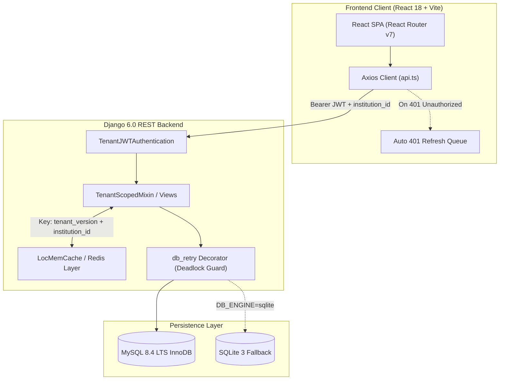
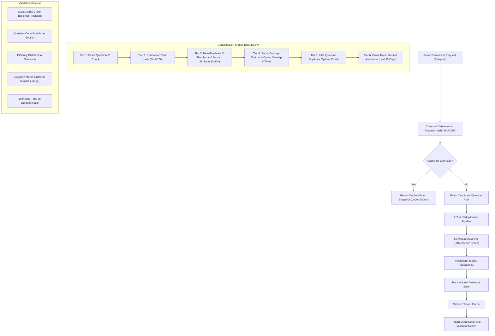
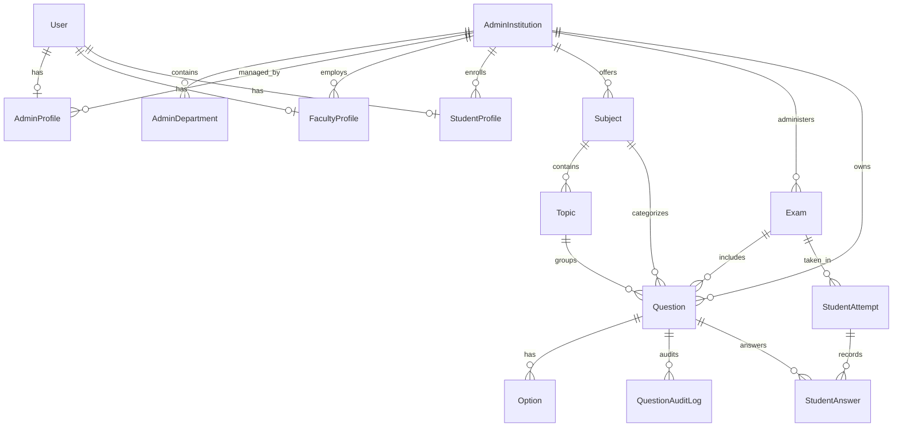

# ExamAI Architecture & Deep Design Guide

## 1. System Overview

ExamAI is designed around a multi-tier, multi-tenant architecture where data segregation, mathematical evaluation accuracy, and high concurrency are enforced at the database, application, and caching levels.



---

## 2. Multi-Tenant Isolation Layer

### Tenant Identity in Authentication
1. **User Association**: Every user belongs to an `AdminInstitution` record through their specific profile:
   - **Admin**: `admins_admininstitution.admin_id = user.id`
   - **Faculty**: `faculty_facultyprofile.institution_id`
   - **Student**: `students_studentprofile.institution_id`
2. **JWT Claims**: When tokens are issued via `/api/admin/login/`, `/api/faculty/login/`, or `/api/student/login/`, the user's `institution_id` is embedded in the JWT payload.
3. **Anti-Spoofing Verification**:
   [`TenantJWTAuthentication`](file:///e:/03%20Study/Django/Mini-Project/api/tenant.py) intercepts every incoming request:
   - Verifies the user against `auth_user`.
   - Fetches the active institution from the database.
   - Compares token `institution_id` with database institution `id`. If a mismatch is detected, it immediately throws `AuthenticationFailed('Security violation: token institution mismatch.')`.
   - Checks institution status; if status is `suspended`, rejects with `AuthenticationFailed('Your institution has been suspended.')`.
   - Injects `request.tenant` (`AdminInstitution`) and `request.tenant_id` into the request context.

### Query Scoping
All querysets are filtered explicitly by institution:
```python
# Standard tenant-scoped query pattern
Exam.objects.filter(institution=request.tenant)
Question.objects.filter(institution=request.tenant)
StudentProfile.objects.filter(institution=request.tenant)
```

---

## 3. High-Performance Multi-Tenant Caching

ExamAI uses an in-memory cache architecture with versioned tenant namespaces. Cache keys are strictly namespaced by `institution_id` and a per-tenant version counter:

### Cache Key Syntax
| Type | Cache Key Format | TTL |
| :--- | :--- | :--- |
| **Paper Snapshot** | `paper:v1:t{t_ver}:inst_{inst_id}:fac_{fac_id}:{request_hash}` | 24 Hours (`86400s`) |
| **Candidate Pool** | `pool:v1:t{t_ver}:inst_{inst_id}:dept_{dept}:sub_{sub_id}:top_{topic}:diff_{diff}:type_{type}` | 10 Minutes (`600s`) |
| **Paper List** | `paperlist:v1:t{t_ver}:inst_{inst_id}:fac_{fac_id}:p{page}:{filters}` | 5 Minutes (`300s`) |
| **Paper Detail** | `paperdetail:v1:t{t_ver}:inst_{inst_id}:exam_{exam_id}` | 24 Hours (`86400s`) |

### Instant Tenant Cache Invalidation
When an administrator or faculty member modifies the Question Bank, imports questions, or publishes an exam:
```python
bump_tenant_cache_version(institution_id)
```
This increments the tenant version counter in cache (e.g. `t1` -> `t2`), instantaneously invalidating all cached papers, candidate pools, and lists for that institution with zero race conditions and zero lingering stale data.

---

## 4. Reusable Zero-Duplicate Paper Generation Engine



---

## 5. Database Entity Relationship (ER) Model


